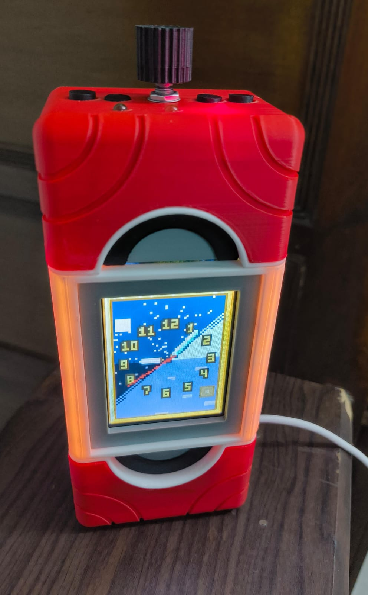
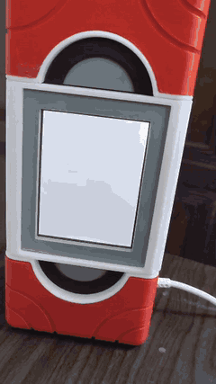
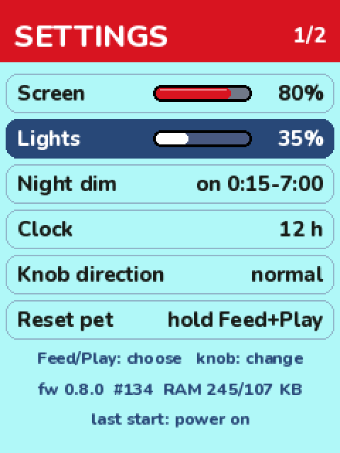
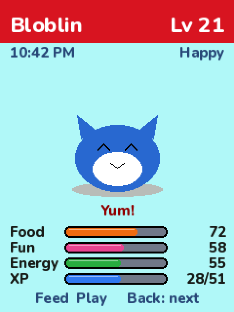
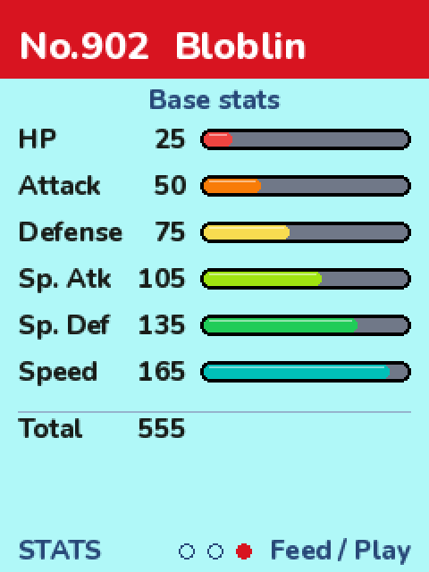
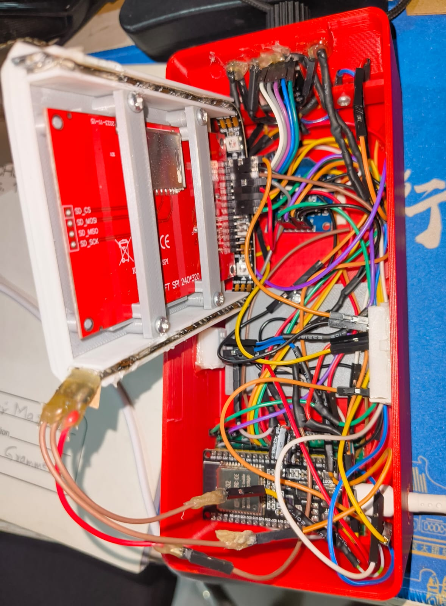

# Kalos Dex
A desk gadget I designed and built, shaped like the expanded Kalos Pokédex from Pokémon X/Y. An ESP32 with a 3.2" screen, a knob, 3 buttons and an LED glow around the screen, always plugged into my PC over USB. It has a virtual pet and a Minecraft-style clock; a PC dashboard and media/volume control is next.

 

The finished box on my desk with the Minecraft clock, and the boot animation.

**Status:** hardware built and the box is closed, firmware v0.8.0 on the device: the pet hatches from an egg and evolves (only when I hold two buttons to allow it), each with its own animation, a Dex page with base stats, and a debug mode for testing on a throwaway copy of the pet. Built with an agent workflow enforced by hooks (below). The PC companion app is next.

  

Renders of the current Settings, Home and Dex STATS screens (the public build shows a placeholder pet with made-up stats; the Pokémon sprites I use on my own unit come from a fan sprite project and aren't redistributed here).

**Why I made it:**
- I used to watch Pokémon and Kalos was my favourite region, mostly because of the animation. When I was thinking about what to build, a Pokédex was the obvious shape. Of all of them, the Kalos one is the cleanest to design and print around: it's basically a screen and its two sides.
- I like Minecraft, and I like watches and clocks, but a plain clock gets boring. I took inspiration from art-piece watches with moving parts and proper articulation. The Minecraft clock already moves (the sky turns with the time of day), so the two fit together: a clock that's functional, interactive and has something moving in it.

**What I did:**
- The idea and the design: what it does, which parts to use, what each button does, which screens to have, and where everything sits inside an 84 x 189 x 55 mm case.
- The firmware requirements: keep it memory-efficient from the start, save the pet's state so nothing is lost, and build one firmware per Pokémon line so the ESP32 only holds the sprites it needs (planned for the pet sprites step).
- Measured every part with calipers and ran test prints to set the printer tolerances (0.2 mm snug, 0.25 mm sliding).
- All the soldering, wiring, 3D printing and assembly, on a fixed parts budget and a single-colour printer.
- Tested every step on the real hardware and caught the problems along the way.
- The rules for how the AI agent works on this project, and the hooks that enforce them (docs/agent-workflow.md).
- The look and feel: after testing on the device I moved the UI from blocky pixel fonts and thin square bars to a rounded font and Pokémon-style HP bars, picked the display settings for my viewing angle by eye, and designed the pet's mood bubbles. Nothing about the pet happens without me: it never evolves or hatches on its own, it waits for my OK.
- The hatching and evolution scenes (v0.8.0): I picked the egg's look from a screenshot of a pixel egg, corrected its outline on previews, and described each beat (the egg hopping while it waits, cracks and rocking, a white flash; for evolving: a dark screen, silhouettes swapping faster and faster, confetti, then the new form showing off a move), then tuned the timing on the device.
- Debug mode: a switch in Settings that copies the pet into a throwaway test pet with cheats (skip time, set bars, jump to an evolution level), so testing never touches the real one.
- The balance target: about a week and a half of normal care to reach the final evolution, hungry by the next morning. The numbers were set with a small simulator before going on the device.
- Keeping it modular for other Pokémon: anything specific to one line (evolution levels, forms, a show-off move per form) is data with a generic fallback, and every plan has to say what a new line would cost.

Inside, with the screen face folded out: the ESP32 on its perfboard carrier at the bottom, hand-wired to every module.

**Build notes** (docs/build-notes.md): the problems and what I chose to do about them. A few of them:
- One roof switch got jammed solid by superglue. Reprinting the tub would have been the longest, most expensive fix, so I designed around it: 3 buttons, and play/pause moved to the knob.
- The neat perfboard layout was too fine for my first real soldering job, so I switched to longer insulated wires pin to pin: less neat, but quicker and easy to check.
- Uploads failed on my home PC but not at the lab; tracked down to USB driver timing and fixed with a capacitor and a custom reset sequence.

**Hardest and most fun:** the wiring and soldering were the hardest part, long and slow. The most fun was the design side: deciding what each button does, which screens to add, and how to manage memory on a chip with no PSRAM.

**Next time:**
- More test prints before the real ones.
- Check the screen's viewing angle on day one: it's a TN panel, and from my desk the colours shift; the UI had to be designed around it later.
- Set up the agent's rules as enforced checks from the start, and expect the first version of each check to need tuning in real use.
- Plan the physical layout as early as the wiring. This time the pin plan was done early but where each part sits in the housing wasn't, and the RTC and the knob board both ended up fighting for space: the RTC holder on the lid sat where the knob's plugs needed to go, and the knob board needed two trims in the printed tub.
- Decide early which test data is throwaway. Testing hatching and evolving on the pet that's meant to be kept would have used it up, so I added a debug mode that tests on a copy, and the gadget's pet only counts once the build is finished.

**How I worked (agentic workflow):**
All the code is written by an AI coding assistant (vibe coded), which also turned my layout and measurements into parametric OpenSCAD. I make the decisions and test everything; the agent plans, writes and checks its own work. The workflow:
- AGENTS.md: the rules the agent follows (plan first, one small tested step at a time, safety warnings before each step, I do all the wiring).
- PLAN.md: design and decisions written down and approved before any code. Firmware steps F0–F9, each with a test that proves it works.
- Every step was built, uploaded and checked on the device (serial logs, test screens, a power test) before the next one. Things that didn't work got redone; docs/build-notes.md has the main ones.
- **Since v0.7.0: a harness that enforces it** (docs/agent-workflow.md, code in agent-harness/). I paused the firmware until the rules were checked by hooks instead of trusted: locked zones of the project that only I can unlock, hard gates so the agent never pushes or rewrites git history (it prepares the line, I run it), every tool call logged, and a step tool that only commits the exact tree that passed the tests and both builds. It's experimental, so the agent reports any problem with it to me first, and a wrong block only gets a fix after it happened 3 times. The page also walks through one real task (the UI redesign) and what had to change in the guards once they met real use.

**Hardware:**
- ESP32 DevKit V1, 3.2" ILI9341 SPI screen, KY-040 knob, 3 buttons (Feed, Play, Back), 16 WS2812B LEDs, 3 status LEDs, DS1307 RTC (modified so it doesn't charge its coin cell).
- Pins: docs/pinout.md, wiring diagram: docs/wiring-diagram/wiring-diagram.html

**Firmware (C++, PlatformIO, Arduino, TFT_eSPI, Adafruit NeoPixel):**
- Virtual pet: stats drop in real time, even while unplugged (it catches up on boot), slower or faster by time of day, XP from every feed and play, levels, mood shown on the LEDs and as a bubble over the pet, reactions to feeding and playing, refuses when full, gets angry after a day without care.
- Hatching and evolving: the egg hatches after a set time (1–60 min, counts while unplugged) and waits for me; when the pet can evolve a "!" blinks. Holding Feed + Play for 3 s starts the scene. Evolution levels and the per-form show-off move are data, so another Pokémon line only needs its own table.
- Dex: entry, a "together" page (met / hatched dates) and base stats as bars coloured by rank, with an extra page when a Pokémon has a second form.
- Debug mode: a test copy of the pet that's never saved, with a cheat screen; switching it off brings the real pet back as it was.
- Pet sprites: one Pokémon line per firmware build (my idea, to save memory), converted from sprite sheets into 4-bit data with a normal and a shiny palette (tools/sprite_convert.py). The sprite data is never committed; without it the build uses a placeholder pet.
- UI: Nunito ExtraBold (SIL Open Font License) converted to anti-aliased bitmap fonts (tools/font_convert.py), Pokémon-style HP bars, layout checked so nothing runs off the screen or under the case's top edge.
- Power-cut-safe saves: every record goes to 2 slots with a sequence number + CRC32. A backup to the PC comes with the companion app.
- Memory budget: no PSRAM and the biggest free RAM block is ~107 KB, so no full-screen buffer; screens draw in strips and only hold big buffers while they're shown.
- LED current limiter keeps the whole gadget under ~450 mA (USB 2 gives 500 mA).
- PC link: line commands over serial (TIME, PING, PET); tools/set_time.py syncs the clock from the PC.

**Not included:** the decorative end caps are cut from a third-party Pokédex prop model that isn't mine to share. Everything else in scad/ is my design.

**To run** (in firmware/kalos-dex): "pio run -e esp32dev -t upload --upload-port COM3" (or -e hwtest for the hardware test screens)

Fan project, not affiliated with Nintendo, Game Freak or The Pokémon Company. MIT license.
